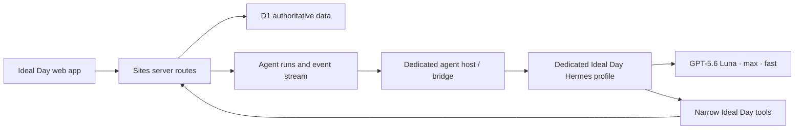

# Ideal Day — Living Product Specification

Status: discovery  
Last updated: 2026-08-19  
Owner: Darren  

This document is the shared source of truth for what we are building. Confirmed decisions are labeled as such. Hypotheses and unresolved questions are kept visible so implementation does not silently turn guesses into product behavior.

## 1. Product thesis

Ideal Day is not just a routine calendar. It is a personal operating system organized around activities.

Each activity combines:

1. A place in an ideal daily sequence.
2. Contextually relevant, structured information.
3. A scoped conversation and scratchpad.
4. An agent that can retrieve context, ask useful questions, and file new information into the correct records.

The calendar is the home screen. Activities are the primary context boundary. A global assistant can see across all activities, while an activity conversation should feel focused on that activity.

## 2. Confirmed product behavior

### 2.1 Home screen

- Show the idealized daily sequence.
- Create a dated “today” plan from the idealized template on the first app open each day.
- Treat today as the default edit target. The user or agent updates the underlying template only when that target is explicitly requested.
- Allow activities to be added, edited, deleted, reordered, and resized in five-minute increments.
- Recalculate downstream times automatically.
- Allow activities to be marked complete. Detailed actual-time tracking is out of scope for now.
- Show a live “Now” line that advances through the schedule.
- Render the activity selected by the current clock in the full expanded-card layout when no other activity has been selected. This expanded layout is the activity’s Now state, with the previously defined header, middle details/chat area, and footer.
- Keep at most one activity expanded. The user can move freely among activities without the clock forcing the interface to jump.
- A clock transition updates which activity is current but never interrupts or replaces the card the user is viewing.
- Completing the expanded Now activity closes it. If the clock has already moved into the next activity, that clock-current activity may then open as the new Now card.
- Leave passed activities above the Now line so they can still be completed or dragged into a later part of today.
- Update today’s remaining schedule dynamically when an activity is moved or resized.
- Inserting an overdue activity into a later position pushes and reschedules every subsequent activity.
- Clicking or tapping an activity expands it.
- Provide a main-page view of the full conversation log across activities.

Completion has two affordances:

- A clear `Complete` action in the expanded card footer.
- A small completion circle on collapsed rows for quickly marking several activities, especially unfinished activities left above the Now position.

Completion changes today’s execution view:

- An activity completed early moves into the passed/completed section above the Now line.
- By default, later activities keep their existing planned times; completing early does not pull the remaining schedule forward.
- Marking it incomplete again leaves it above the Now line as unfinished/overdue rather than automatically reinserting it into the future schedule.
- The user can drag that unfinished activity back into a later position when desired.
- Activities above the Now line preserve their original schedule order rather than sorting by completion time.

Deleting from a daily plan must confirm the scope. The confirmation explains: “This removes the activity from today only. Your template will not change.” Its only actions are `Cancel` and `Remove from today`. Template deletion is a separate explicit action while editing the template.

### 2.2 Expanded activity

An expanded activity has two major areas.

#### Contextual details

The top area presents information that is useful for the activity right now. Examples:

- Hair Serum: current product, start date, day number, instructions, and recent adherence.
- Lifting: last workout, recent sets/reps/weights, current targets, useful trend or comparison.
- Resupply: active shopping list, urgency, source activity, and when an item was added.

This section should be concise, scannable, and interactive when appropriate. It is not merely an agent-written paragraph.

#### Activity conversation

The lower area is a conversation and scratchpad scoped to the activity. It supports:

- Quick notes without requiring a carefully worded prompt.
- Questions to the assistant.
- Agent follow-up questions.
- Structured filing of facts, logs, measurements, tasks, and changes.
- Retrieval of relevant history.

The user should not have to decide where every piece of information belongs. The agent should infer a destination, make the write through a typed tool, and preserve an audit trail.

The interaction is closer to a quiet chat room than a formal prompt box:

- Use familiar iOS Messages/Telegram conventions: readable bubbles, message grouping, restrained timestamps, conventional spacing, and standard delivery states.
- Use a somewhat larger multiline input with a visible Send button.
- `Enter` sends and `Shift+Enter` inserts a newline on keyboard devices.
- Notes are sent into the conversation and processed by the agent.
- The agent does not need to post a conversational reply unless the user asked a question or a response is otherwise necessary.
- Successful filing is communicated with messaging-style checkmarks rather than an extra assistant response. One gray check means the message is durably saved and waiting for Luna; double checkmarks mean Luna has read and processed it.
- Each activity has one permanent conversation with date separators rather than separate daily threads.
- The main page contains one unfiltered, chronological running conversation with the global assistant.
- An expanded activity shows only its permanent activity conversation.
- When a global message causes activity-specific work, the relevant output or linked reference must also appear in that activity’s conversation. Example: toothpaste mentioned globally produces a visible Resupply entry so the information can be found from either context.
- Cross-posted activity output retains a link to its originating global message without duplicating the entire global conversation.

### 2.3 Mobile schedule contract

Mobile should begin directly at the Schedule. Do not show the desktop supertext, hero title, explanatory subtitle, or start/finish/length summary.

Collapsed activity cards should use a compact, deliberately mobile layout:

- Keep the activity icon and title prominent.
- Put the activity time and tag on the title line, right aligned.
- Truncate long titles with an ellipsis instead of compressing the row.
- Put edit and delete on the same controls line, immediately left of the duration controls.
- Make the minus/duration/plus control only as wide as its contents require.
- Keep controls touch-friendly without making the card unnecessarily tall.

When an activity expands:

- The header contains icon, title, time, and tag.
- The middle contains the contextual details UI and activity-scoped conversation.
- The footer contains edit, delete, and the compact duration control.
- The footer also contains the primary `Complete` action.
- The expansion should feel like part of the card rather than an unrelated modal.

### 2.4 Settings

Settings begins with one behavior option:

- `Pull remaining schedule forward after early completion` — default off.

When enabled, completing an upcoming activity removes its planned time and shifts the remaining activities earlier. When disabled, completing early leaves the remaining planned times unchanged.

## 3. Core conceptual model

The product must distinguish these concepts:

- **Activity definition:** the durable concept, such as “Hair Serum” or “Lift.”
- **Routine item:** the activity’s position and planned duration in an idealized routine.
- **Daily plan:** a dated snapshot created from a routine template and independently editable for that day.
- **Activity run:** one real occurrence on a date, including completion and logs. Detailed actual timing can be added later.
- **Fact:** durable current knowledge, such as the serum product currently in use.
- **Observation:** something recorded at a moment, such as “out of toothpaste” or “bench 185 × 8.”
- **Task/item:** actionable state, such as a resupply item.
- **Conversation:** messages scoped globally, to an activity, or optionally to one activity run.
- **Agent action:** a proposed or completed structured change with provenance.

This separation prevents the ideal routine, today’s execution, historical data, and chat transcript from collapsing into one ambiguous list.

### Activity as a context lens

An activity is the primary UX context, but it is not a database folder that must exclusively own every relevant record. The expanded activity gathers the information needed for that activity while the underlying records retain their own type, lifecycle, provenance, and relationships.

Each record may have:

- One primary context when there is a natural owner.
- Zero or more related activities.
- An originating message and, when applicable, an originating activity run.
- Explicit provenance identifying user input, agent inference, or an external source.
- A filing state, including `needs_clarification` when the destination or interpretation is uncertain.

Capture must never fail merely because Luna cannot classify it confidently. The original message is saved immediately, remains visible, and may stay unfiled while Luna asks a normal conversational follow-up question.

Activities and schedule placement are independent. An activity may be a durable, always-available context without appearing in the routine, while a routine item is an optional scheduled placement of that activity. This allows operational contexts such as Resupply to exist without requiring a daily time block.

The expanded activity acts as a small workbench with four conceptual layers:

1. **Do now:** current instructions, controls, checklist, or next action.
2. **Current state:** durable facts and the most relevant recent history.
3. **Open loops:** tasks, unanswered questions, pending decisions, and follow-ups.
4. **Capture:** the permanent activity conversation and scratchpad.

Full history remains available through retrieval or a dedicated history view, but the default expanded state prioritizes what is useful now.

## 4. Agent contract

The model is not the database. The chat transcript is not the database. The application database is authoritative.

For each turn, the system should assemble a context packet containing only what is useful:

- User and app preferences.
- Activity definition and routine context.
- Current or most recent activity run.
- Current facts and open items.
- Recent relevant observations.
- Relevant prior messages.
- Cross-activity information retrieved because it appears useful.
- Open agent questions.

Context preparation is live and event-driven rather than a blanket start-of-day model pass:

- Persist each activity’s current details so they are already ready whenever the activity opens.
- Reprocess affected activities immediately when a message or data change alters their context.
- Invoke Luna for user messages, relevant record changes, explicit requests, or scheduled events that genuinely require judgment.
- Do not invoke Luna merely because a new date started.
- At first open on a new date, deterministic application code creates today’s plan and updates date-derived values such as product day counts. This work does not require a model call.
- Example: “I need toothpaste” entered during Bed Prep should update Resupply immediately without waiting for Resupply to open.

Agent questions follow normal messaging behavior:

- A question is a normal Luna message in the relevant conversation, not a separate questionnaire UI.
- The main interface may show a simple notification icon or unread indicator at most.
- A question can be answered from the global conversation or from its activity conversation; linked context keeps both views synchronized.

The agent can then return:

- A conversational response.
- Zero or more typed data mutations.
- Zero or more follow-up questions.
- An optional update to the activity’s details presentation.

For note-only messages, a valid outcome is structured filing with no assistant chat response.

Initial app-specific agent tools should be narrow and auditable:

- `get_activity_context`
- `search_activity_history`
- `search_global_history`
- `append_observation`
- `upsert_fact`
- `log_metric`
- `create_or_update_item`
- `create_follow_up_question`
- `update_activity`
- `update_routine_item`
- `mark_activity_run`

The agent should not receive raw SQL access. It should not receive a general terminal or filesystem by default. Every write should be validated server-side and recorded with its source message and agent run.

## 5. Details UI strategy

### Recommended starting point

Use a stable, app-owned component library for the details area. The agent selects and fills approved cards rather than inventing arbitrary HTML.

Candidate components:

- Key/value summary
- Product card
- Day/adherence counter
- Recent-history list
- Metric trend
- Workout comparison
- Checklist or shopping list
- Warning or attention card
- Small data-entry form

The application remains responsible for spacing, typography, responsive behavior, accessibility, and interaction quality.

Every activity receives the complete expanded experience from the first release: contextual details, permanent activity conversation, live agent processing, questions, and activity-appropriate actions. There is no limited pilot set or second-class generic card.

When an activity has little or no known context, its details area uses a useful empty state and Luna can ask a normal conversational question. Missing data must not make the expansion unavailable.

### OpenUI position

OpenUI is a credible later layer for generative details because it can stream structured UI from a controlled component library. It should not be the source of truth and should not render unrestricted model-generated HTML for core records.

Proposed approach:

1. Build the first details cards directly in React.
2. Define typed card contracts.
3. Pilot OpenUI using those same approved contracts.
4. Keep a deterministic fallback renderer for every persisted card.

## 6. Persistence and data model

### Decision

Move durable product state from `localStorage` to the project’s D1 database before adding activity conversations and agent-managed records.

`localStorage` may remain for temporary drafts and device-only preferences, but not as the source of truth for activities, notes, history, or conversations.

### Draft schema

- `users`
- `routines`
- `activities`
- `routine_items`
- `activity_runs`
- `facts`
- `observations`
- `metrics`
- `items`
- `conversations`
- `messages`
- `agent_questions`
- `agent_runs`
- `agent_actions`
- `agent_jobs`
- `record_relations`
- `agent_session_bindings`
- `record_revisions`
- `detail_view_snapshots` (optional cache, not authoritative data)
- `attachments` (metadata in D1; bytes in R2 when needed)

Typed activity data can use a hybrid model:

- Common fields live in first-class relational columns.
- Specialized records use a validated `type` plus versioned JSON payload.
- Frequently queried specialized domains can graduate to dedicated tables later, such as workout sets.

`record_relations` prevents cross-activity information from being duplicated merely so it can appear in multiple contexts. `agent_session_bindings` maps one permanent product conversation to one or more runtime sessions over time so Hermes compression, resets, recovery, or replacement cannot break product history.

### Migration

On first authenticated database-backed load:

1. Read the existing local routine.
2. Import it once into D1.
3. Record a migration marker.
4. Keep a short rollback/export path.
5. Stop merging future hard-coded defaults into the user’s saved list.

## 7. Candidate runtime architecture

The subscription credentials belong on the dedicated agent host, never in browser JavaScript or D1.

The first agent host will be the owner’s PC. A later host may be:

- A private VPS.
- A later managed service if subscription authentication and security permit it.

The web app must save notes and remain usable while the PC agent is offline. Agent work queues durably and retries after the local bridge reconnects. Retries must be idempotent so reconnects cannot file the same message twice.

There is no paid API fallback. If GPT-5.6 Luna cannot be reached through the ChatGPT subscription bridge, processing waits and retries later.

The browser never connects directly to Hermes. The PC bridge leases durable jobs from the application, calls Hermes over localhost, relays bounded run progress, and commits only validated application mutations. A message is considered saved when D1 accepts it and processed only after its agent job reaches a terminal successful state; Hermes transport acknowledgements alone do not produce double checkmarks.

## 8. Hermes evaluation

### Why Hermes is promising

- It has a full agent loop, sessions, search across prior sessions, skills, scheduled work, and custom tools/plugins.
- It exposes an API server that external UIs can use.
- It supports OpenAI Codex OAuth through a ChatGPT subscription.
- It supports request-scoped model, reasoning, and service-tier controls.
- It is better aligned with a persistent all-around assistant than a bare model call.

### Why Hermes is not automatically the whole backend

- Hermes’ built-in curated memory is intentionally small; app records still need D1.
- Its session database is useful agent infrastructure, not the product’s canonical data model.
- Its API runtime can expose powerful tools, including terminal access, unless deliberately restricted.
- We need explicit mappings between activity conversations and Hermes sessions.
- Proactive processing, retries, idempotency, and write approvals still require product-level design.

### Working recommendation

Use Hermes as the initial agent runtime behind a contained integration boundary. Create one dedicated Ideal Day profile with its own identity, configuration, credentials, sessions, and minimal tool surface. Disable terminal, filesystem, browser, delegation, cron, general memory, and unrelated tools for app-triggered runs.

Ideal Day remains authoritative for messages and structured knowledge. Hermes session history is runtime infrastructure rather than product history. One permanent Ideal Day conversation may map to several Hermes sessions over its lifetime. If Hermes state is lost, the app can create a replacement session from a focused context packet and relevant product messages.

Expose the app contract to Hermes as a narrow authenticated MCP server or local MCP adapter. Business validation, ownership checks, write policy, record-level approvals, revisions, and idempotency remain server-side in Ideal Day. Do not parse assistant prose to infer mutations; successful typed tool calls and committed D1 records are authoritative.

Hermes long-term memory is initially disabled for application facts. If enabled later, it is limited to stable user communication preferences or other deliberately selected global context. Products, protocols, health-adjacent facts, observations, metrics, tasks, and activity history remain in D1 and are retrieved per turn.

Hermes interactive clarification and MCP elicitation are not the product’s asynchronous question mechanism. When context is missing, Luna calls `create_follow_up_question`, completes the current run, and resumes work from the user’s later reply rather than holding a local process open.

The bridge and application own durable job states such as `queued`, `leased`, `running`, `waiting_for_user`, `succeeded`, and `retryable_failure`. Every mutation carries an application-generated idempotency key derived from the agent job and logical action, so reconnects or replay cannot create duplicates.

The first end-to-end acceptance spike is:

1. Enter “I’m almost out of toothpaste” from Bed Prep while the PC agent is offline.
2. Save the message and show one gray check without blocking the user.
3. Bring the bridge and Hermes online and lease the queued job.
4. Retrieve Bed Prep, Resupply, open-item, and relevant message context.
5. Call `create_or_update_item` and create one Resupply item linked to the original Bed Prep message.
6. Show the linked result in Resupply and update the original message to double checkmarks.
7. Replay the same job and prove that no duplicate item or revision is created.
8. Enter “Actually, I bought it” and close the existing item through a revision with preserved provenance.

The broader Hermes evaluation must also test:

1. Activity-scoped conversation continuity.
2. Cross-activity retrieval.
3. Typed writes with a visible audit trail.
4. GPT-5.6 Luna with max reasoning and Fast mode through the ChatGPT subscription.
5. Recovery when the agent host is offline or a run is interrupted.

Do not deepen product coupling to Hermes until these paths work. The MCP contract, durable queue, D1 records, and conversation model must remain portable to another agent runtime.

## 9. Codex app-server alternative

Codex app-server is also viable for a deep custom client. Official OpenAI documentation describes ChatGPT-managed OAuth, conversation history, approvals, streamed events, and ChatGPT rate-limit information.

It is less obviously suited than Hermes to a long-lived personal information assistant, and its remote WebSocket transport is currently documented as experimental and unsupported for production. It remains a useful lower-level alternative or a runtime Hermes can invoke.

## 10. Trust, privacy, and control

This app will contain health-adjacent personal data. The initial product needs:

- Private authenticated access.
- Server-side ownership checks on every record.
- Encryption in transit.
- No subscription tokens in the browser or database.
- An audit log of agent mutations.
- Conversational correction of agent writes with append-only database revision history.
- No general-purpose record editor, visible change-history screen, or message-level undo in the initial UI.
- Clear distinction between user-entered facts, agent inference, and external research.
- No autonomous high-impact health decisions.
- Export and deletion paths.
- Conservative handling of attachments and sensitive notes.

## 11. Delivery phases

### Phase 0 — product specification

- Maintain the confirmed product and infrastructure decisions in this living specification.
- Define acceptance criteria for the first complete activity flow.

### Phase 1 — database foundation

- [x] Enable D1 and authenticated user ownership.
- [x] Migrate the existing routine from local storage with a one-time migration marker.
- [x] Add routines, activities, and routine items.
- [x] Create an independently editable daily plan from the template.
- [ ] Add user-facing export/restore.

### Phase 2 — expanded activities without AI

- [ ] Add a polished mobile and desktop expander.
- [ ] Add the universal expanded-card shell and deterministic details renderer to every activity.
- [ ] Add activity-scoped notes and history.
- [ ] Add activity runs and basic typed logs.
- [ ] Add the Now line, completion, overdue state, and rescheduling within today.
- [x] Implement the collapsed mobile schedule contract: begin at Schedule, omit the desktop hero and summary, keep title/time/tag on one line, truncate long titles, use compact duration controls, align edit/delete separately, and center the drag handle.
- [ ] Implement the expanded mobile schedule contract, including the details/chat middle and completion footer.

### Phase 3 — universal scoped agent

- Connect one agent runtime.
- Add one permanent conversation and full agent behavior to every activity.
- Add read-only contextual retrieval.
- Add proposed writes and explicit confirmation.

### Phase 4 — trusted agent writes

- Add low-risk automatic filing.
- Add audit history, conversational correction, conflict handling, and idempotency.
- Add proactive questions and details preparation.
- Add event-driven cross-activity updates.

### Phase 5 — global assistant

- Add cross-activity chat.
- Add schedule changes, resupply capture, and cross-domain retrieval.
- Add background processing and notifications after explicit policy decisions.

## 12. Decisions recorded so far

- The ideal-day schedule remains the home screen.
- Each day gets an editable daily plan derived from an editable template.
- Scheduling and completion are in scope; detailed actual-time tracking is deferred.
- A live Now line separates passed and upcoming schedule content without removing missed activities.
- The clock-selected activity automatically uses the expanded card as its Now state.
- Only one card is expanded at a time, and user navigation always takes precedence over automatic Now presentation.
- Clock changes update time state without moving the UI. Completing the active Now card is the one automatic handoff that may open the next clock-current card.
- Completion is available through both an expanded `Complete` button and a small collapsed-row circle for batch catch-up.
- Completing early moves an activity above the Now line. Reversing completion leaves it there as overdue until the user reschedules it.
- Completing early preserves later planned times by default. Settings can opt into pulling the remaining schedule forward.
- The passed section preserves original schedule order.
- Removing an activity from today requires a two-action scope-confirmation modal and never changes the template.
- Missed activities can be dragged into a later part of today.
- Moving a missed activity later reschedules all following activities.
- Activities expand in their existing row/card on desktop and mobile.
- Mobile begins at Schedule and omits the desktop hero and summary sections.
- Mobile uses compact content-width duration controls and a single-line title/time/tag header.
- Expanded activities contain contextual details and an activity-scoped conversation.
- Every activity receives the complete details/chat/agent experience at launch; none are held back as prototypes.
- The main page can show the full cross-activity conversation log.
- The main page has one unfiltered chronological conversation with a global assistant.
- Each activity has one permanent dated conversation.
- Global actions that affect an activity produce a linked output/reference in that activity conversation.
- Activity conversations behave as quiet chat rooms: notes are processed without requiring an assistant reply.
- Chat follows standard iOS/Telegram visual and interaction conventions, including bubbles, a touch-friendly Send button, and processing checkmarks.
- One gray check means saved/queued; double checkmarks mean processed by Luna.
- The agent can understand information across the app.
- Activity details are prepared in advance and updated immediately when relevant information changes elsewhere.
- Activity context is maintained continuously through live event processing; there is no blanket start-of-day Luna pass.
- Day rollover performs deterministic plan/date housekeeping without invoking the model.
- Agent questions appear as normal messages and use only a lightweight notification/unread indicator.
- Questions can be answered globally or in their originating activity.
- The app database, not chat history, is the source of truth.
- Durable state should move to D1 before agent features are layered on.
- Agent writes happen automatically through typed tools and preserve provenance and correctability.
- The agent may change the schedule when requested, but should not optimize or rearrange it unsolicited.
- Cross-activity sources should be tracked internally; whether to expose them routinely in the UI is unresolved.
- OpenUI is a presentation option, not a database or agent runtime.
- Hermes is the initial agent runtime for a contained integration spike, while the app contract remains portable to another runtime.
- Activities are UX context lenses rather than exclusive record containers; records may relate to multiple activities while retaining one canonical identity.
- Capture is saved even when Luna cannot confidently classify it; unresolved filing becomes a durable conversational follow-up rather than an error.
- Activities may exist without scheduled routine placement.
- Ideal Day conversations are permanent product records and may map to multiple Hermes runtime sessions over time.
- The dedicated Ideal Day Hermes profile exposes only the narrow app tool surface for app-triggered work.
- Hermes long-term memory does not store canonical application facts; D1 remains authoritative.
- The PC bridge, not the browser, communicates with Hermes over localhost and owns durable queue leasing and reconciliation.
- Successful typed tool writes, not assistant prose or Hermes transport acknowledgements, determine whether a message is processed.
- Agent clarification is asynchronous: Luna records a follow-up question and completes the run instead of holding an interactive process open.
- The first agent runtime will run on the owner’s PC.
- Offline agent work waits in a durable, duplicate-safe queue and retries after the PC bridge reconnects.
- The product does not fall back to paid API usage when the ChatGPT subscription bridge is unavailable.
- The initial product scope is wellness. Attachments and wearable integrations are not immediate requirements.
- Original chat messages are retained indefinitely unless the user explicitly deletes them.
- Structured records retain provenance links to their originating messages.
- Incorrect records are corrected by telling Luna in chat. Luna writes a revision and preserves the superseded value in database history.
- Most structured records are not directly editable by the user.
- Database audit/revision history is retained but has no dedicated UI in the initial product.
- There is no message-level Undo action in the initial product.
- Proactive wellness recommendations are deferred to a later stage. Initially Luna organizes, retrieves, compares, files information, and asks for missing context; it may still answer wellness questions when explicitly asked.

## 13. Open questions

There are no unresolved discovery blockers for the initial product architecture. Implementation may surface narrower interaction or infrastructure decisions, which should be added here before assumptions are committed to code.

## 14. Research sources

- OpenAI GPT-5.6 Luna model: https://developers.openai.com/api/docs/models/gpt-5.6-luna
- OpenAI Codex speed and Fast mode: https://learn.chatgpt.com/docs/agent-configuration/speed
- OpenAI Codex app-server: https://learn.chatgpt.com/docs/app-server
- Hermes Agent repository: https://github.com/NousResearch/hermes-agent
- Hermes API server: https://hermes-agent.nousresearch.com/docs/user-guide/features/api-server
- Hermes sessions: https://hermes-agent.nousresearch.com/docs/user-guide/sessions/
- Hermes profiles: https://hermes-agent.nousresearch.com/docs/user-guide/profiles/
- Hermes MCP integration and tool filtering: https://hermes-agent.nousresearch.com/docs/user-guide/features/mcp/
- Hermes hooks: https://hermes-agent.nousresearch.com/docs/user-guide/features/hooks
- Hermes security: https://hermes-agent.nousresearch.com/docs/user-guide/security/
- Hermes persistent memory: https://hermes-agent.nousresearch.com/docs/user-guide/features/memory/
- Hermes OpenAI/Codex provider: https://hermes-agent.nousresearch.com/docs/integrations/providers/
- OpenUI generative UI: https://www.openui.com/docs/agent/core-concepts/generative-ui
- OpenUI repository: https://github.com/thesysdev/openui
