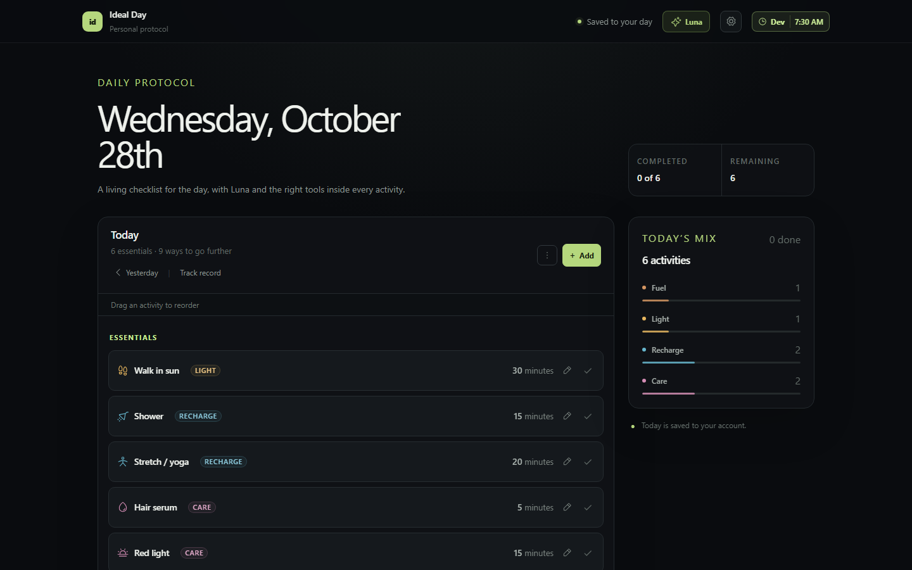
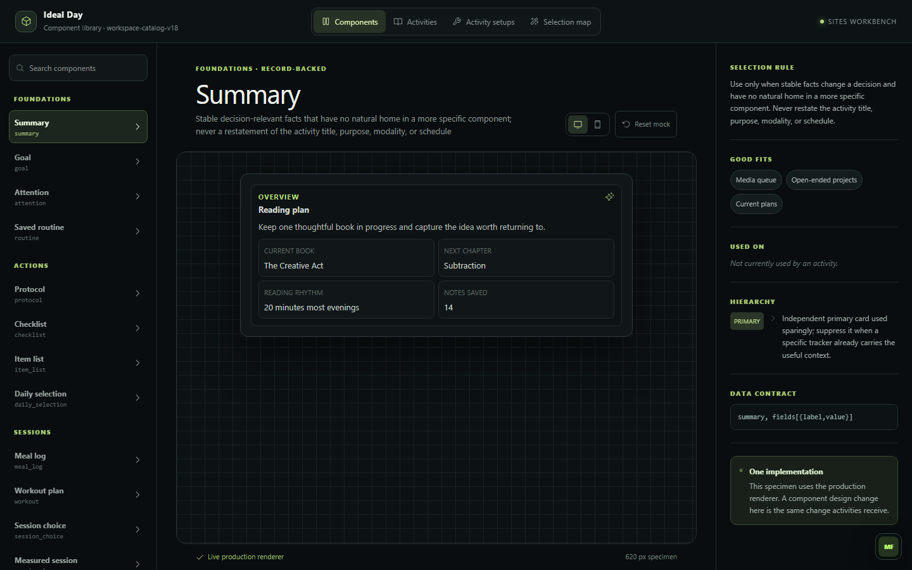

# Ideal Day

A daily planner organized around activities. An AI agent, Luna, builds each activity's interface from an app-owned component library, and the app validates every change before it is saved.



## What it is

Ideal Day organizes a day around activities: strength training, cardio, a face-care routine, meals, supplements and more. Each activity has its own workspace, history and conversation. You tell the in-app agent, Luna, what you did or what you want ("I plan to use it once a week"), and the activity updates to match: a product card, a protocol, a cadence, a session log.

The premise, from `PRODUCT_SPEC.md`, is that a day is better organized around activities than around a calendar. Each activity combines a place in an ideal daily sequence, structured information relevant to it, a scoped conversation, and an agent that files new information into the right records. The home screen is a flexible daily checklist; clock scheduling is optional.

## What's interesting

- **The agent proposes, the app decides.** Luna never writes to the screen or the database. It returns typed actions (record, workspace, move, schedule proposal, dated occurrence), and `app/activity-record-model.ts`, `app/workspace-model.ts` and `app/schedule-model.ts` validate them before anything is saved. A completion receipt is written only from changes that actually committed.
- **Bounded failure handling.** A rejected save gets one correction in the same session that quotes the exact reason and tells the model to ask a question instead of inventing data. Only malformed output and rejections raised before anything was saved are corrected. An ambiguous network or server failure is never resubmitted as a correction: the lease is released and the job is retried in a fresh session, up to three attempts. See `bridge/result-correction.mjs` and `tests/bridge-correction.test.mjs`.
- **An app-owned component library.** The agent composes activities from the 26 component types in `bridge/component-catalog.mjs`. The app refuses to lease work to a bridge running a different catalog version, and a test fails if the `/components` workbench lacks a specimen for any catalog type. Products and devices are subject roots that own their records, and moving one between activities is a single validated action (`COMPONENT_RELATIONSHIPS.md`).
- **Durable agent work.** Jobs live in the database with leases and heartbeats. Every attempt gets a fresh agent session so retries cannot accumulate prompt history, and a final attempt that stops responding is marked failed instead of being left in progress. The UI shows work immediately and says Luna will catch up when the agent is offline.
- **Model routing from an isolated eval.** The eval replays a real request through the production prompt, component catalog and validators, in throwaway sessions with nothing applied to the app. Configurations that failed the validators or filed data under the wrong activity were ruled out. Method and results are in `evals/README.md`.

## How it works

```
Browser --> App (vinext on Cloudflare Workers) --> D1 (SQLite, Drizzle)
                  ^   durable job queue: leases, heartbeats, validation
                  |   outbound HTTPS only
           Bridge worker (Node) --> local Hermes agent runtime --> model
```

- `app/` is the React 19 app on [vinext](https://github.com/cloudflare/vinext) (the Next.js App Router API on Vite), with the API routes and validators. It is deployed to OpenAI Sites and runs as a Cloudflare Worker with a D1 database. The schema is in `db/` and 25 Drizzle migrations are in `drizzle/`.
- `bridge/` is a Node worker that polls the app for jobs, builds the prompt from the component catalog and the activity's records, calls the agent runtime ([Hermes Agent](https://github.com/NousResearch/hermes-agent)), and posts the result back for validation. Linked pages are fetched and cached before the building step.
- Luna has two paths: a fast conversational model (`gpt-5.6-luna`) that acknowledges and answers right away, and a separate building model (`gpt-5.6-terra`) that does the durable work. Model IDs are set in `bridge/ideal-day-bridge.mjs` and can be overridden by environment variable.
- `vercel-gateway/` is a small Vercel project that adds a two-user password login in front of the app (scrypt-hashed passwords, signed session cookies).
- Specs: `PRODUCT_SPEC.md`, `DESIGN_SYSTEM.md`, `SCHEDULING_SYSTEM_SPEC.md`, `COMPONENT_RELATIONSHIPS.md`.

## Running it locally

Requires Node.js 22.13 or later.

```bash
npm ci
npm run db:migrate:local   # once: creates the local development database
npm run dev                # http://localhost:3000
npm test                   # build, then the app tests and the gateway tests
npm run lint
```

The app, tests and lint need no environment variables and no API keys. The local app opens on a sample routine. Without the bridge running, agent requests queue until a worker picks them up. CI runs the tests on Ubuntu; the bridge's launcher and supervisor scripts (`bridge/*.ps1`) are Windows PowerShell.

### Try it without the agent

With `npm run dev` running, open `/components` for the workbench: every catalog component rendered by the production renderer with fixture data. `/luna-demo` is the motion study for Luna's avatar.



### Running the agent

Start the Hermes agent runtime with a profile named `ideal-day` (API server on `127.0.0.1:8643`), then run `npm run bridge`. Against a non-local app URL the bridge needs `IDEAL_DAY_APP_URL`, `IDEAL_DAY_BRIDGE_TOKEN` and `IDEAL_DAY_SITES_BYPASS_TOKEN`. All variable names are listed in `.env.example`, and the gateway's are in `vercel-gateway/.env.example`.

## Status

In use since August 2026. The agent builds each activity's interface through the validated path described above, and the model routing is the result of the eval in `evals/`. The suite has 246 app tests and 10 gateway tests. Store tests apply the real Drizzle migrations to in-memory SQLite, and one simulates a response lost after commit to prove retries are idempotent.

## How it was built

Designed and directed by Darren Mills, and built with AI coding agents working against contracts he set: the product spec and design system, the agent rules in `AGENTS.md`, a 26-type component catalog the app enforces, regression tests that pin those contracts, a brief for an agent that tests the product as a user (`SMART_FLOW_USER_TESTING.md`), and the model-routing eval. `design/track-record-2026-09-20/` traces one feature from concept boards to the chosen design, implementation plan and verification note.

## License

MIT. See [LICENSE](LICENSE).
